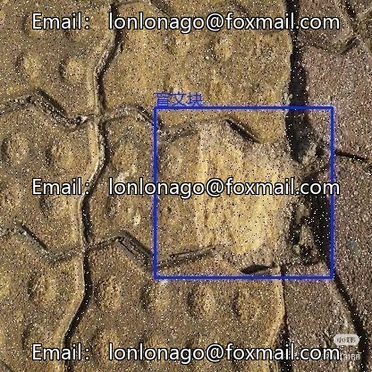
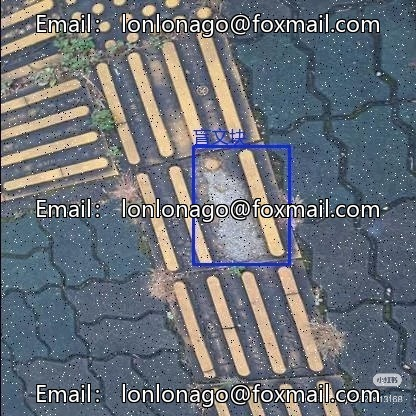
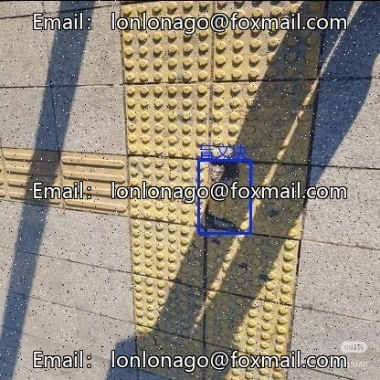
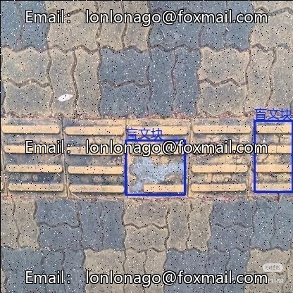

# Smart City Blind Path Image Recognition Dataset, Road Brick Defect Detection, Including Cracked Tiles

## Body

Smart City Blind Path Image Recognition Dataset, Road Brick Defect Detection, including common issues such as tile cracking, damage, road cracks, and potholes, approximately 4100 high-quality labeled images, covering 5 types of frequent defect types, with balanced sample distribution.

The dataset supports the Yolo+VOC format, is compatible with mainstream detection frameworks, and is suitable for urban infrastructure defect detection and automatic inspection system development, enhancing urban operational efficiency.

Data collection from actual urban scenes, with diverse lighting, weather conditions, and shooting angles. Annotations are standardized, bounding boxes accurately capture defect areas, suitable for rapid experimentation, algorithm validation, and edge deployment prototype development.

Virtual materials, once sold, are non-refundable.
Interested friends, click "I want" to proceed.

## Images

## Payment

Here is a pay link on Stripe ( https://buy.stripe.com/3cs8yP7sY87d0vu9AB ). Please contact me lonlonago@foxmail.com after funding $89, and I will send you a complete data files , thank you!

